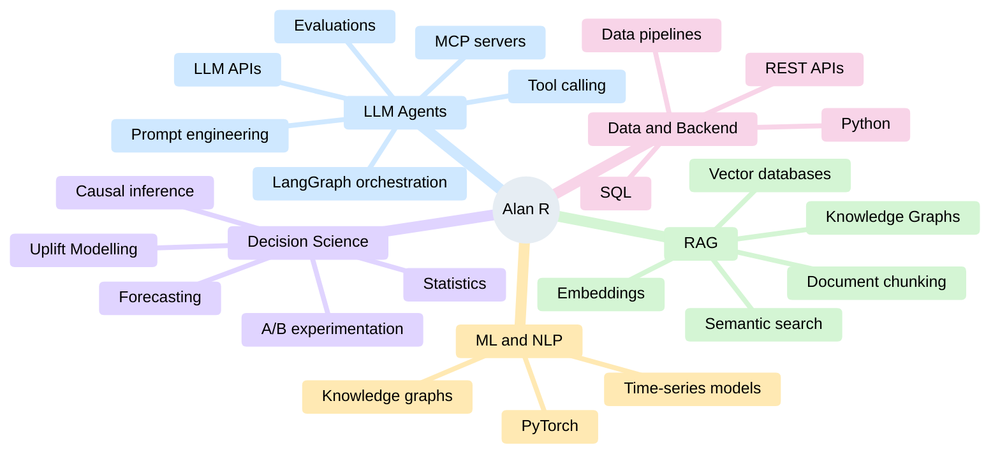
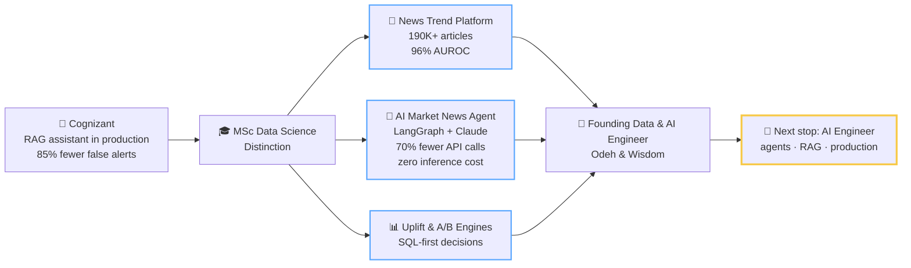

<picture>
  <!-- Image for Dark Mode (Yellow) -->
  <source media="(prefers-color-scheme: dark)" srcset="https://readme-typing-svg.herokuapp.com?font=Fira+Code&duration=2000&pause=998&color=4AF626&width=435&lines=Hi,+I'm+Alan;AI+Engineer+%26+Data+Scientist;">
  <!-- Image for Light Mode (Purple) -->
  <source media="(prefers-color-scheme: light)" srcset="https://readme-typing-svg.herokuapp.com?font=Fira+Code&duration=2000&pause=1000&color=000000&width=435&lines=Hi,+I'm+Alan;AI+Engineer+%26+Data+Scientist;">

  <!-- Fallback Image (shows if the browser doesn't support the picture tag) -->
  
</picture>

AI Engineer & Data Scientist. I build AI and Data Solutions to solve problems.

### 🧰 Toolkit

### 📬 Connect

&nbsp;&nbsp;&nbsp;

&nbsp;&nbsp;&nbsp;

### 🗺️ The route so far

| Stop | What it proves | Link |
|---|---|---|
| 🤖 AI Market News Agent | LangGraph + Claude agent, 70% fewer API calls | [repo](https://snooze-news.vercel.app/) |
| 🧠 News Trend Platform | Embeddings and trend detection at 190K+ articles | [docs](https://reptilianpride.github.io/AlansPortfolioPage/files/DissertationReport.pdf) |
| 📊 Uplift Engine | Who gets the intervention under a fixed budget | [repo](https://github.com/ReptilianPride/Customer-Intervention-Profit-Optimization-Engine) |
| 🧪 Experimentation Engine | A/B evidence into SHIP / DON'T SHIP decisions | [repo](https://github.com/ReptilianPride/Experimentation-Causal-Decision-Engine) |