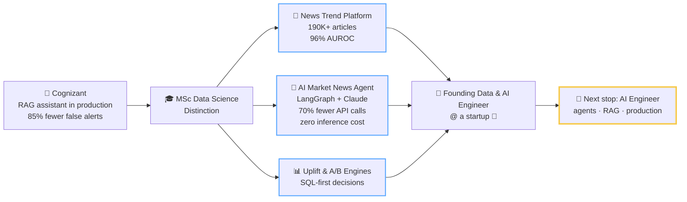

## Hi, I'm Alan
### AI Engineer & Data Scientist

I build AI and Data Solutions to solve ALL problems.

| Area | Technologies & Skills |
|:---|:---|
| **LLM Agents** | LangGraph, LLM APIs, Tool Calling, MCP, Prompt Engineering, Evaluations |
| **RAG** | Semantic Search, Embeddings, Vector DBs, Chunking, Knowledge Graphs |
| **ML & NLP** | PyTorch, Time-Series Models, Knowledge Graphs |
| **Data & Backend** | Python, SQL, REST APIs, Data Pipelines |
| **Decision Science** | Uplift Modelling, A/B Testing, Causal Inference, Statistics, Forecasting |  

&nbsp;  
<a href="https://github.com/ReptilianPride?tab=repositories">
  <picture>
    <source media="(prefers-color-scheme: dark)" srcset="https://img.shields.io/badge/View_All_Repositories-FFFFFF?style=for-the-badge&logo=github&logoColor=black">
    
  </picture>
</a>

### 🧰 Toolkit

### 📬 Connect

&nbsp;&nbsp;&nbsp;

&nbsp;&nbsp;&nbsp;

| Stop | What it proves | Link |
|---|---|---|
| 🤖 AI Market News Agent | LangGraph + Claude agent, 70% fewer API calls | [repo](https://snooze-news.vercel.app/) |
| 🧠 News Trend Platform | Embeddings and trend detection at 190K+ articles | [docs](https://reptilianpride.github.io/AlansPortfolioPage/files/DissertationReport.pdf) |
| 📊 Uplift Engine | Who gets the intervention under a fixed budget | [repo](https://github.com/ReptilianPride/Customer-Intervention-Profit-Optimization-Engine) |
| 🧪 Experimentation Engine | A/B evidence into SHIP / DON'T SHIP decisions | [repo](https://github.com/ReptilianPride/Experimentation-Causal-Decision-Engine) |

### 🗺️ The route so far

